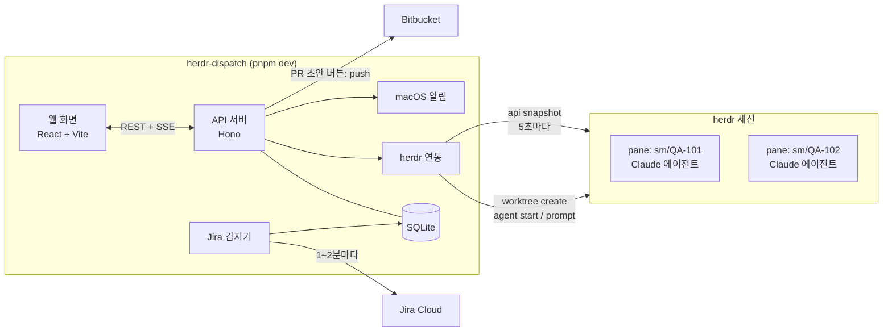
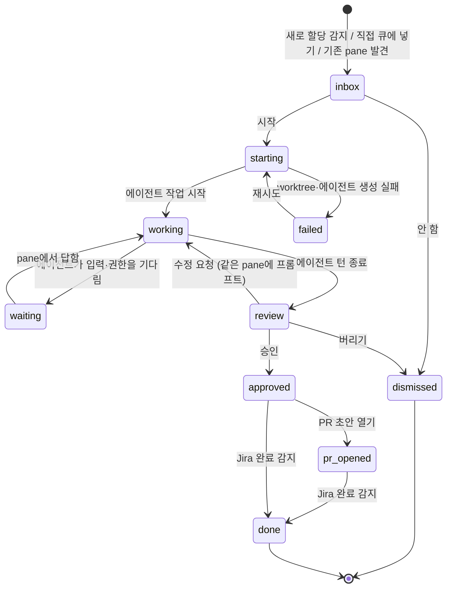

# Jira 작업 큐 설계

> 상태: 초안 (2026-10-19)
> 대상: 개인용 로컬 도구 herdr-dispatch

## 1. 목표와 범위

### 목표

1. **놓치지 않기**: 나에게 할당된 티켓과 내 티켓에 생긴 일(할당, 상태 변경, 댓글, 멘션)을 한곳에서 바로 알아챈다.
2. **큐로 관리하기**: 새로 할당된 티켓이 "받은 일"로 쌓이고, 내가 고른 것만 Claude가 작업한다.
3. **타입별 작업**: QA 버그, 개발 티켓 등 티켓 종류에 맞는 작업 방식(플레이북)으로 맡긴다.
4. **작업 현황 한눈에 보기**: herdr pane에서 돌고 있는 에이전트가 작업 중인지, 내 답을 기다리는지, 끝났는지를 대시보드에서 본다.
5. **확인 후 PR**: 끝난 작업은 "확인 필요"로 오고, 내가 승인해야 PR 초안 단계로 간다.

### 하지 않는 것

- **자동 시작**: 감지는 자동이지만 작업 시작은 항상 내가 누른다.
- **Claude의 외부 작업**: push, PR 생성, Jira 상태 변경, Jira·PR 댓글 작성은 Claude가 하지 않는다.
- **에이전트 실행기 직접 구현**: 지금 쓰는 herdr(worktree pane + Claude 에이전트)를 그대로 쓰고, 대시보드는 지휘와 상황판 역할만 한다.
- **원격 배포·다중 사용자**: 내 맥에서 나 혼자 쓴다.

## 2. 전체 구조



| 구성 요소 | 역할 |
| --- | --- |
| Jira 감지기 | Jira를 주기적으로 조회해 티켓 캐시와 이벤트를 갱신하고, 새로 할당된 티켓을 "받은 일"로 만든다 |
| herdr 연동 | 작업 시작 시 worktree pane과 에이전트를 만들고 프롬프트를 보낸다. 에이전트 상태를 주기적으로 읽어 작업 상태에 반영한다 |
| API 서버 | 화면 요청 처리, 상태 전이, SSE로 실시간 갱신 전달 |
| 알림 | 브라우저를 닫아 둬도 macOS 알림으로 알려준다 |

- **herdr를 쓰는 이유**: 이미 티켓 작업을 herdr pane에서 하고 있다. 에이전트가 터미널에 그대로 보이니 언제든 들어가서 개입할 수 있다. Claude Code의 권한 설정, 로그인, 스킬도 평소 그대로 쓴다. 대시보드가 실행기를 따로 만들면 이 장점이 사라지고 인증·권한 문제를 새로 풀어야 한다.
- **웹훅 대신 폴링을 쓰는 이유**: Jira 웹훅은 외부에서 접근 가능한 주소와 관리자 권한이 필요하다. 1~2분 폴링으로 충분하다.

## 3. 용어

| 용어 | 뜻 |
| --- | --- |
| 이벤트 | Jira 변경 이력 한 건 또는 댓글 한 건. "새 소식"에 보인다 |
| 작업 | 티켓 하나를 에이전트에게 맡기는 단위. 큐의 카드 하나이고 herdr 에이전트 하나와 연결된다 |
| 플레이북 | 작업 방식. 에이전트에게 보낼 프롬프트 템플릿과 완료 조건을 묶은 것 |
| 받은 일 | 감지됐지만 아직 시작하지 않은 작업 |

## 4. 데이터 모델 (SQLite)

```sql
-- Jira 티켓 캐시
tickets (
  key TEXT PRIMARY KEY,         -- QA-101
  summary TEXT, type TEXT, status TEXT, category TEXT,
  project_key TEXT, area TEXT,  -- 'qa' | 'dev'
  priority TEXT, reporter TEXT, versions TEXT, first_release TEXT,
  assigned_to_me INTEGER,       -- 0 | 1
  updated_at TEXT, synced_at TEXT
)

-- 새 소식
events (
  id TEXT PRIMARY KEY,          -- QA-101:h:12345 / QA-101:c:678
  ticket_key TEXT, kind TEXT,   -- assigned | created | status | comment | mention | field
  actor TEXT, detail TEXT, at TEXT,
  read_at TEXT                  -- NULL이면 안 읽음
)

-- 작업 큐
tasks (
  id INTEGER PRIMARY KEY,
  ticket_key TEXT, area TEXT,
  playbook TEXT,                -- qa-fix | dev-plan | dev-implement | triage
  state TEXT,                   -- 5장 참고
  base_branch TEXT,             -- origin/release/2.4.0 등
  branch TEXT,                  -- sm/QA-101
  worktree_path TEXT,           -- ~/.herdr/worktrees/<repo>/sm-qa-101
  agent_name TEXT,              -- herdr 에이전트 이름 (qa-101)
  pane_id TEXT,                 -- wQ:p1
  agent_status TEXT,            -- herdr가 마지막으로 알려준 상태
  completion_seq INTEGER,       -- 마지막으로 처리한 herdr 완료 번호
  result_json TEXT,             -- 7.4 결과 형식
  created_at TEXT, started_at TEXT, finished_at TEXT
)
```

규칙:

- **작업 하나 원칙**: 티켓 하나에 진행 중인 작업은 하나만 있다. 끝난 작업(완료, 버림)은 기록으로 남는다.
- **이벤트 중복 방지**: 이벤트 ID는 Jira의 변경 이력·댓글 ID를 쓴다. 같은 이벤트가 두 번 들어와도 한 건만 남는다.
- **읽음 상태**: 지금 브라우저 localStorage에 있는 것을 DB로 옮긴다.
- **로그는 저장하지 않음**: 에이전트 출력은 herdr pane에 있다. 화면에서는 필요할 때 `herdr agent read`로 읽어서 보여준다.

## 5. 작업 상태



| 상태 | 화면 이름 | 바뀌는 계기 |
| --- | --- | --- |
| `inbox` | 받은 일 | 감지기, 내가 "큐에 넣기", 또는 기존 herdr pane 발견(6.4) |
| `starting` | 시작 중 | 내가 "시작"을 누름 |
| `working` | 작업 중 | herdr 상태 `working` |
| `waiting` | 입력 대기 | herdr 상태 `blocked`. 권한 확인이나 질문에 내 답이 필요함 |
| `review` | 확인 필요 | herdr 상태가 `working`에서 `done`/`idle`로 바뀜 (7.3) |
| `failed` | 실패 | worktree 생성, 에이전트 시작, 프롬프트 전송 중 오류 |
| `approved` | 승인됨 | 내가 승인 |
| `pr_opened` | PR 초안 | 내가 "PR 초안 열기"를 누름 |
| `done` | 완료 | Jira에서 티켓이 완료됨 |
| `dismissed` | 버림 | 내가 버림 |

## 6. 감지

### 6.1 Jira 조회

| 용도 | JQL | 비고 |
| --- | --- | --- |
| 내 티켓 | `assignee = currentUser() AND statusCategory != Done` | 받은 일 생성, 내 티켓 목록 |
| 새 소식 | `(assignee = currentUser() OR reporter = currentUser() OR watcher = currentUser()) AND updated >= -7d` + `expand=changelog` | Jira가 알림을 보내는 대상과 같은 범위 |

### 6.2 받은 일을 만드는 규칙

- **첫 동기화**: 이미 할당돼 있던 티켓은 "내 티켓"에만 넣고 받은 일로는 만들지 않는다. 처음 켰을 때 큐가 넘치지 않게 하기 위해서다.
- **이후**: 다음 경우 받은 일을 만든다.
  - 담당자가 나로 바뀐 이벤트가 새로 감지됐을 때
  - 나에게 할당된 상태로 새 티켓이 생겼을 때
- **만들지 않는 경우**: 상태가 backlog이거나, 그 티켓에 진행 중인 작업이 이미 있을 때.
- **직접 넣기**: "내 티켓" 목록의 어느 행에서든 "큐에 넣기"로 받은 일을 만들 수 있다.

### 6.3 티켓 상태 변화에 따른 처리

| Jira에서 일어난 일 | 처리 |
| --- | --- |
| 티켓이 완료 상태가 됨 | 관련 작업을 `done`으로 바꾼다. worktree는 지우지 않는다 |
| 담당자가 다른 사람으로 바뀜 | 작업 카드에 "담당자 변경됨" 경고를 단다. 상태는 자동으로 바꾸지 않는다 |
| QA가 다시 열었음 (완료 → 미완료) | 새 소식으로 알리고 받은 일을 다시 만든다 |

### 6.4 기존 herdr 작업 가져오기

대시보드 밖에서 시작한 작업도 큐에 보이게 한다. 손으로 띄워 둔 티켓 pane도 함께 관리하기 위해서다.

- **찾는 방법**: herdr 스냅샷에서 `cwd`가 `~/.herdr/worktrees/<repo>/sm-<티켓키>` 형태인 에이전트를 찾는다.
- **연결**: 티켓 키를 뽑아 작업으로 등록하고, 지금 에이전트 상태에 맞는 작업 상태로 넣는다.
- **연결이 끊긴 경우**: 대시보드가 만든 작업의 pane이 사라졌으면 카드에 "pane 없음"으로 표시하고 다시 열기 버튼을 준다 (`herdr worktree open`).

## 7. 작업 실행 (herdr 연동)

### 7.1 플레이북

시작 전 카드에서 플레이북을 바꿀 수 있다. 아래는 기본으로 고르는 규칙이다.

| 조건 | 플레이북 | 에이전트가 하는 일 | 코드 수정 |
| --- | --- | --- | --- |
| QA 프로젝트(`QA_PROJECTS`) + 버그 | `qa-fix` | QA 수정용 스킬로 원인 확인, 최소 수정, 검증 | 함 |
| 그 외 프로젝트 (개발) | `dev-plan` | 티켓·기획서·Figma를 읽고 구현 계획과 확인할 질문만 작성 | 안 함 |
| `dev-plan` 승인 후 | `dev-implement` | 같은 pane에서 승인된 계획대로 구현 (규모가 크면 `sd` 파이프라인) | 함 |
| 그 외 | `triage` | 티켓 요약, 빠진 정보, 예상 작업 범위 정리 | 안 함 |

- **개발 티켓을 두 단계로 나눈 이유**: 범위가 크고 기획 해석이 필요하다. 계획을 먼저 보고 방향을 잡아야 버리는 작업이 줄어든다.
- **정의 위치**: 플레이북은 `server/playbooks.ts` 한 파일에 조건, 프롬프트 템플릿, 완료 조건으로 정의한다.
- **프롬프트에 담는 것**:
  - 티켓 링크
  - 작업 브랜치와 기준 브랜치
  - 완료 범위
  - 지켜야 할 것: push·PR·Jira 쓰기 금지, 로컬 커밋까지만
  - 끝나면 결과 파일을 남길 것 (7.4)

### 7.2 시작할 때

지금 손으로 하고 있는 순서를 그대로 자동화한다.

```bash
# 1. 기준 브랜치 결정: 팀 브랜치 규칙 (수정 버전 → master 또는 release/feature 브랜치)
# 2. worktree pane 만들기 (메인 repo는 그대로 둔다)
herdr worktree create --branch sm/QA-101 --base origin/<기준 브랜치> --label QA-101 --no-focus
# 3. 그 pane에서 Claude 에이전트 시작
herdr agent start qa-101 --kind claude --pane <생성된 pane>
# 4. 플레이북 프롬프트 전송
herdr agent prompt qa-101 "<플레이북 프롬프트>"
```

- 각 명령 결과(JSON)에서 workspace, pane, worktree 경로를 읽어 `tasks`에 저장한다.
- 하나라도 실패하면 `failed`로 두고 오류 메시지를 카드에 보여준다.
- **동시 작업 수 제한 없음**: 시작은 내가 하나씩 누르기 때문이다. 다만 "작업 중"이 3개를 넘으면 카드 위에 경고를 띄운다.

### 7.3 진행 상황 추적

서버가 5초마다 `herdr api snapshot`을 읽어 에이전트 상태를 작업 상태로 옮긴다.

| herdr `agent_status` | 작업 상태 | 알림 |
| --- | --- | --- |
| `working` | `working` | - |
| `blocked` | `waiting` | ✓ "QA-101 입력 대기" |
| `done` / `idle` (직전이 `working`이고 `completion_seq`가 늘었을 때) | `review` | ✓ "QA-101 확인 필요" |
| 에이전트 없음 | 상태 유지, 카드에 "pane 없음" | - |

- **완료 판단 근거**: `completion_seq`가 증가했는지로 판단한다. 같은 완료를 두 번 처리하지 않기 위해서다.
- **수정 요청 후**: 같은 pane에 프롬프트를 보내면 다시 `working`이 되고, 같은 흐름이 반복된다.
- **화면에서 보는 것**:
  - 마지막 출력: `herdr agent read`로 읽어 카드 상세에 표시
  - "pane 열기" 버튼: `herdr agent focus`로 터미널의 해당 pane으로 바로 이동

### 7.4 결과 파일

에이전트는 턴을 마칠 때 아래 파일을 남긴다. 위치는 저장소 밖인 `~/.herdr-dispatch/results/<티켓키>.json`이다. worktree 안에 두면 커밋에 섞일 수 있어서다.

```json
{
  "outcome": "done | needs_input | failed",
  "summary": "무엇을 왜 바꿨는지 3~5줄",
  "changedFiles": ["src/..."],
  "verification": [{ "command": "pnpm type-check", "passed": true }],
  "questions": ["기획 확인이 필요한 점"],
  "prDraft": { "title": "fix: ...", "body": "..." }
}
```

- **파일이 있을 때**: 서버가 파일을 읽어 확인 화면을 채운다. `needs_input`이면 질문을 맨 위에 보여준다.
- **파일이 없을 때**: 에이전트가 질문으로 턴을 끝냈을 수도 있다. 이 경우 확인 화면에 `herdr agent read`의 마지막 출력을 보여준다.

## 8. 확인과 PR

### 8.1 확인 화면

작업 카드를 열면 오른쪽 패널에 네 탭이 나온다.

| 탭 | 내용 |
| --- | --- |
| 요약 | 결과 요약, 검증 결과, 질문 |
| 변경사항 | worktree에서 `git diff <기준 브랜치>...HEAD` |
| 출력 | 에이전트 마지막 출력 (`herdr agent read`) |
| 티켓 | Jira 티켓 내용과 링크 |

### 8.2 버튼

| 버튼 | 동작 |
| --- | --- |
| pane 열기 | 터미널의 해당 herdr pane으로 이동해 직접 대화한다 |
| 수정 요청 | 입력한 피드백을 같은 pane에 프롬프트로 보낸다 |
| 승인 | `approved`로 바꾼다 |
| 버리기 | 확인 후 `herdr worktree remove`로 정리하고 `dismissed`로 바꾼다 |
| PR 초안 열기 | 승인된 작업에서만 보인다. 동작은 아래 순서를 따른다 |

**PR 초안 열기**

1. 내가 버튼을 누르면 서버가 작업 브랜치를 push한다.
2. Bitbucket PR 생성 화면(`/pull-requests/new?source=<브랜치>&dest=<기준 브랜치>`)을 연다.
3. 제목과 본문은 화면에 복사 버튼과 함께 보여준다. Bitbucket URL로는 미리 채울 수 없어서다.
4. PR 제출은 Bitbucket 화면에서 내가 직접 누른다. "PR은 사용자가 직접 올린다"는 규칙을 그대로 지킨다.

## 9. 알림

| 상황 | macOS 알림 | 화면 |
| --- | --- | --- |
| 새로 할당됨 (받은 일 생성) | ✓ | 받은 일 카드, 탭 배지 |
| 나를 멘션한 댓글 | ✓ | 새 소식 강조 |
| 에이전트 입력 대기 | ✓ | 카드가 입력 대기 열로 이동 |
| 에이전트 작업 끝 (확인 필요) | ✓ | 카드가 확인 필요 열로 이동, 탭 제목 숫자 |
| 작업 시작 실패 | ✓ | 실패 카드 |
| 그 외 상태 변경·댓글 | ✗ | 새 소식 |

- **macOS 알림**: 서버에서 `osascript`로 띄우므로 브라우저를 닫아 둬도 온다. `terminal-notifier`가 설치돼 있으면 알림을 눌렀을 때 대시보드가 열린다.
- **브라우저 알림**: 화면을 열어 둔 상태라면 탭 제목에 확인할 개수를 표시한다.
- **herdr 알림과 겹칠 때**: herdr도 에이전트 완료 알림을 띄운다. 둘 다 오면 시끄러우므로, 대시보드 설정에서 "에이전트 알림은 herdr에 맡김"을 고를 수 있게 한다.

## 10. 화면

```
┌ herdr-dispatch ─ [전체] [QA] [개발] ──────── 🔍 찾기    새로고침 · 1분 전 ┐
│                                                                          │
│  작업 큐                                                                  │
│ ┌ 받은 일 2 ──┐┌ 작업 중 1 ──┐┌ 입력 대기 1 ┐┌ 확인 필요 1 ┐┌ 완료 ─────┐ │
│ │ QA-103 QA   ││ QA-101 QA   ││ QA-102 QA   ││ DEV-201     ││ QA-98     │ │
│ │ 버그 제목   ││ qa-fix 12분 ││ 권한 확인   ││ 계획 ✓      ││           │ │
│ │ qa-fix ▾    ││ [pane 열기] ││ [pane 열기] ││ [확인하기]  ││           │ │
│ │[시작][안 함]││             ││             ││             ││           │ │
│ └─────────────┘└─────────────┘└─────────────┘└─────────────┘└───────────┘ │
│                                                                          │
│  새 소식 4                         │  내 티켓                              │
│  ● 멘션 QA-99 담당자: @... 확인     │  진행 중 7 · 해야 할 일 2 · …         │
│  ● 상태 QA-97 진행 중 → 재오픈      │  [큐에 넣기] QA-96 …                  │
└──────────────────────────────────────────────────────────────────────────┘
```

- **QA/개발 구분**: 상단 탭은 전체, QA, 개발 세 개다. 카드와 목록에 QA(주황), 개발(파랑) 색을 입혀 전체 탭에서도 구분된다.
- **열 구성**: 큐 열은 받은 일 → 작업 중 → 입력 대기 → 확인 필요 → 완료 순이다. 승인됨과 PR 초안은 확인 필요 열 안에서 배지로 구분한다.
- **정렬**: 입력 대기와 확인 필요 열은 오래 기다린 것이 위로 온다. 나머지 열은 최근 변경 순이다.
- **카드 내용**: 티켓 키, 제목, 영역 색, 플레이북, 경과 시간, 상태별 버튼.

## 11. 기술 스택과 폴더 구조

| 영역 | 선택 | 이유 |
| --- | --- | --- |
| 화면 | React + Vite + TanStack Query (현재 코드 유지) | 평소 쓰는 스택이라 직접 고치기 쉽다 |
| 서버 | Node 24 + TypeScript + Hono | 가볍고 SSE 지원이 간단하다 |
| 저장 | `node:sqlite` (Node 24 내장) | 별도 설치 없이 재시작 후에도 상태가 남는다 |
| 에이전트 실행 | herdr CLI (JSON 출력) | 지금 쓰는 작업 방식 그대로, 터미널에서 개입 가능 |
| 실시간 갱신 | SSE | 서버에서 화면으로 한 방향이면 충분하다 |

```
herdr-dispatch/
├─ server/
│  ├─ index.ts         # Hono 앱, REST + SSE
│  ├─ db.ts            # SQLite 스키마, 쿼리
│  ├─ jira.ts          # Jira REST (현재 src/jira 이동)
│  ├─ poller.ts        # Jira 감지, 받은 일 생성 규칙
│  ├─ herdr.ts         # herdr CLI 호출, 스냅샷 → 작업 상태 반영
│  ├─ tasks.ts         # 상태 전이 (5장 표를 코드로)
│  ├─ playbooks.ts     # 7.1 표, 프롬프트 템플릿
│  ├─ git.ts           # diff, push (PR 초안 버튼)
│  └─ notify.ts        # macOS 알림
├─ web/                # 현재 src/ 이동
└─ docs/design.md
```

- **실행**: `pnpm dev` 하나로 서버와 화면을 같이 띄운다. Vite가 `/api` 요청을 서버로 넘긴다.
- **토큰 보관**: Jira 토큰은 서버만 갖는다.

## 12. 안전장치 요약

- **내가 눌러야만 일어나는 일**: 작업 시작, 승인, push.
- **에이전트의 권한 경계**: 에이전트는 평소 Claude Code 권한 설정 그대로 pane에서 돈다. 위험한 명령은 권한 확인으로 멈추고, 그 상태가 "입력 대기"로 보인다.
- **프롬프트로 정하는 범위**: push·PR·Jira 쓰기를 하지 않고 로컬 커밋까지만 한다고 명시한다.
- **메인 repo 보호**: 메인 repo의 브랜치는 건드리지 않는다. 모든 작업은 herdr worktree에서 한다.
- **서버 접근 범위**: `127.0.0.1`에만 연다.
- **토큰 보관**: `.env`에만 두고 화면 코드와 로그에 남기지 않는다.

## 13. 구현 순서

| 단계 | 내용 | 끝났다고 보는 기준 |
| --- | --- | --- |
| 1 | 서버 이전, SQLite, Jira 감지기, 받은 일, 큐 화면, macOS 알림 | 새로 할당된 티켓이 받은 일 카드와 알림으로 나타난다 |
| 2 | herdr 상태 추적: 기존 pane 가져오기, 상태 반영, pane 열기, 출력 보기 | 이미 돌고 있는 티켓 pane이 올바른 열에 보인다 |
| 3 | 시작 버튼: 기준 브랜치 결정, worktree·에이전트 생성, 플레이북 프롬프트 전송 | 받은 일 카드에서 시작을 누르면 pane이 생기고 작업 중으로 이동한다 |
| 4 | 확인 화면: 결과 파일, diff, 수정 요청, 승인, PR 초안 열기 | 승인한 작업으로 Bitbucket PR 생성 화면까지 간다 |
| 5 | `dev-plan` → `dev-implement` 흐름, 플레이북 다듬기 | 개발 티켓 하나를 계획 승인 후 구현까지 진행한다 |

2단계를 3단계보다 먼저 하는 이유: 이미 돌고 있는 pane만으로 상태 추적을 검증할 수 있어서다. 새 pane을 만드는 기능 없이도 확인할 수 있다.

## 14. 구현 전에 정할 것

| 항목 | 질문 | 제안 |
| --- | --- | --- |
| 완료 판단 | herdr의 `done`과 `idle` 차이, `completion_seq` 증가 시점이 "에이전트 턴 종료"와 정확히 맞는지 | 2단계에서 실제 pane으로 확인 후 7.3 표 확정 |
| herdr 세션 | herdr 서버가 꺼져 있을 때의 동작 | 상단에 "herdr 연결 안 됨" 표시, 시작 버튼 비활성화 |
| Bitbucket | PR 생성 화면 URL에 쓸 workspace와 저장소 이름 | `git remote -v`에서 읽기 |
| 티켓 맥락 | 기획서(Confluence)·Figma를 에이전트가 읽을 수 있는지 | 프롬프트에는 링크만 넣고, 읽기는 에이전트의 Atlassian·Figma MCP에 맡기기 |
| 결과 파일 | 에이전트가 결과 파일을 매번 잘 남기는지 | 플레이북 프롬프트 끝에 형식을 명시. 없으면 마지막 출력으로 대체 (7.4) |
